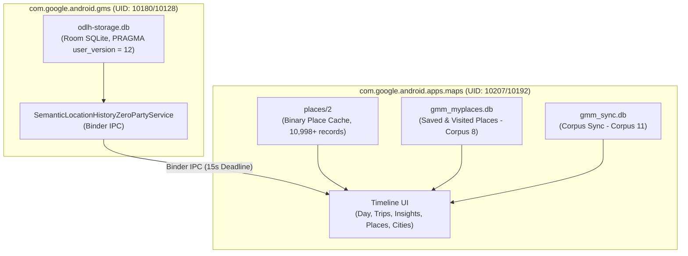

# Google Maps On-Device Location History (ODLH) Protobuf & Storage Architecture
## Complete Engineering Specification, Wire Encodings, Binary Cache & Storage Layout

---

## 1. Overview & System Topology

On-Device Location History (ODLH) stores historical location traces, trips, visits, and semantic activities locally on the Android device under Google Play Services (`com.google.android.gms`) and Google Maps (`com.google.android.apps.maps`).



---

## 2. Protobuf Binary Wire Layout

### 2.1 `semantic_segment_table.semantic_segment` BLOB

Every record in `semantic_segment_table` stores a serialized Protobuf message in `semantic_segment`.

#### Root Message Wrapper:
```protobuf
message SemanticSegmentRecord {
    required TimestampProto start_time = 1;     // Wire: Tag 1 (0x0A) Length-Delimited
    required TimestampProto end_time = 2;       // Wire: Tag 2 (0x12) Length-Delimited
    required SegmentPayload payload = 3;        // Wire: Tag 3 (0x1A) Length-Delimited (Visit or Activity)
    optional string segment_id = 6;             // Wire: Tag 6 (0x32) Length-Delimited (e.g. "qg_seg_12345")
    required int64 start_timezone_offset = 7;   // Wire: Tag 7 (0x38) 64-bit Varint (two's complement)
    required int64 end_timezone_offset = 8;     // Wire: Tag 8 (0x40) 64-bit Varint (two's complement)
    optional int32 is_finalized = 10;           // Wire: Tag 10 (0x50) Varint (1 = finalized)
}

message TimestampProto {
    required int64 timestamp_seconds = 1;       // Wire: Tag 1 (0x08) Varint
}
```

#### Timezone Offset Varint Encoding (Tags 7 & 8)
Timezones are stored as signed 64-bit varints (two's complement):
- **EDT (UTC-4, -240 min)**: `\x90\xfe\xff\xff\xff\xff\xff\xff\xff\x01`
- **EST (UTC-5, -300 min)**: `\xd4\xfd\xff\xff\xff\xff\xff\xff\xff\x01`
- **CET (UTC+1, +60 min)**: `\x3c`
- **CEST (UTC+2, +120 min)**: `\x78`
- **UTC (0 min)**: `\x00`

---

### 2.2 Visit Segment Payload (`segment_type = 1`)

Inside Root Tag 3 (`0x1A`):
```protobuf
message VisitSegmentPayload {
    optional VisitDetails visit_details = 1;    // Wire: Tag 1 (0x0A) Length-Delimited
}

message VisitDetails {
    optional int32 semantic_type = 1;           // Wire: Tag 1 (0x08) Varint (0 = POI)
    optional float confidence = 2;              // Wire: Tag 2 (0x15) 32-bit Float (1.0f -> \x00\x00\x80\x3f)
    optional PlaceCandidate candidate = 4;      // Wire: Tag 4 (0x22) Length-Delimited
}

message PlaceCandidate {
    required FeatureIdProto feature_id = 1;     // Wire: Tag 1 (0x0A) Length-Delimited
    optional int32 semantic_type = 2;           // Wire: Tag 2 (0x10) Varint (0 = POI)
    optional float score = 3;                   // Wire: Tag 3 (0x1D) 32-bit Float (1.0f)
    required PointProto location = 5;           // Wire: Tag 5 (0x2A) Length-Delimited
}
```

#### `FeatureIdProto` (Tag 1: `0x0A` inside `PlaceCandidate`)
```protobuf
message FeatureIdProto {
    required fixed64 feature_fprint = 1;        // Wire: Tag 1 (0x09) 64-bit Little-Endian
    required fixed64 s2_cell_id = 2;            // Wire: Tag 2 (0x11) 64-bit Little-Endian
}
```
* **Wire Encoding**: `\x09` + `struct.pack('<Q', fprint)` + `\x11` + `struct.pack('<Q', cell_id)`

#### `PointProto` (Tag 5: `0x2A` inside `PlaceCandidate` / Tag 1 & 2 inside `ActivityDetails`)
```protobuf
message PointProto {
    required sfixed32 lat_e7 = 1;               // Wire: Tag 1 (0x0D) 32-bit Little-Endian Signed Int
    required sfixed32 lng_e7 = 2;               // Wire: Tag 2 (0x15) 32-bit Little-Endian Signed Int
}
```
* **Wire Encoding**: `\x0d` + `struct.pack('<i', int(lat * 1e7))` + `\x15` + `struct.pack('<i', int(lng * 1e7))`

---

### 2.3 Activity Segment Payload (`segment_type = 2`)

Inside Root Tag 3 (`0x1A`):
```protobuf
message ActivitySegmentPayload {
    optional ActivityDetails activity_details = 2; // Wire: Tag 2 (0x12) Length-Delimited
}

message ActivityDetails {
    required PointProto start_point = 1;           // Wire: Tag 1 (0x0A) Length-Delimited
    required PointProto end_point = 2;             // Wire: Tag 2 (0x12) Length-Delimited
    required float distance_meters = 3;            // Wire: Tag 3 (0x1D) 32-bit Float
    optional WaypointListProto simplified_raw_path = 4; // Wire: Tag 4 (0x22) Length-Delimited (Road-Snapped Polyline)
    required ActivityCandidate candidate = 6;      // Wire: Tag 6 (0x32) Length-Delimited
}

message ActivityCandidate {
    required int32 activity_type = 1;              // Wire: Tag 1 (0x08) Varint
    required float score = 2;                      // Wire: Tag 2 (0x15) 32-bit Float (1.0f -> \x00\x00\x80\x3f)
}
```

#### Activity Type Enums (`activity_type`):
| Value | Enum Identifier | Google Maps Display Text & UI Icon |
| :---: | :--- | :--- |
| `1` | `IN_PASSENGER_VEHICLE` | 🚗 **Driving** / In Passenger Vehicle |
| `2` | `WALKING` | 🚶 **Walking** (Pedestrian) |
| `3` | `CYCLING` | 🚲 **Cycling** (Bicycle / Citi Bike) |
| `4` | `FLYING` | ✈️ **Flying** (Commercial Flight) |
| `7` | `RUNNING` | 🏃 **Running** |
| `8` | `IN_BUS` | 🚌 **In bus** |
| `9` | `IN_TRAIN` | 🚆 **In train** |
| `10` | `IN_SUBWAY` | 🚇 **In subway** |
| `11` | `IN_FERRY` | ⛴️ **In ferry** |

> [!IMPORTANT]
> To prevent Google Maps from rendering fallback generic "Moving", `ActivityCandidate` MUST be encoded under Tag 6 (`0x32`) inside `ActivityDetails` (Tag 2 `0x12`), and `activity_type` MUST be set to `2` (Walking) or `3` (Cycling).

---

### 2.4 Road-Snapped Waypoints (`simplified_raw_path` - Tag 4: `0x22`)

```protobuf
message WaypointListProto {
    repeated WaypointProto waypoints = 1;          // Wire: Tag 1 (0x0A) Length-Delimited
}

message WaypointProto {
    required sfixed32 lat_e7 = 1;                  // Wire: Tag 1 (0x0D) 32-bit Little-Endian Signed Int
    required sfixed32 lng_e7 = 2;                  // Wire: Tag 2 (0x15) 32-bit Little-Endian Signed Int
    optional int64 timestamp_ms = 3;               // Wire: Tag 3 (0x18) Varint
    optional float accuracy_meters = 4;            // Wire: Tag 4 (0x25) 32-bit Float
}
```

---

## 4. Google Maps Timeline UI Rendering Engine Contracts

The following behavioral rules govern how the Google Maps client (`com.google.android.apps.maps`) interprets the database and renders timeline UI items:

### Rule 1: The Zero-Type-3 Insertion Contract (No Generic "Moving")
- In ODLH, polyline waypoints are embedded directly inside `ActivitySegmentPayload` (`segment_type = 2`) via Tag 4 (`WaypointListProto`).
- Inserting a separate `RawPathSegment` (`segment_type = 3`) with `shown_in_timeline = 1` causes Google Maps to render a duplicate, unclassified "Moving" card in the UI.
- **Contract**: `segment_type = 3` rows MUST NOT be inserted when an `ActivitySegment` exists, or must have `shown_in_timeline = 0`.

### Rule 2: Strict Polyline Endpoint Pinning
- When Google Maps renders an activity polyline between Place A and Place B, it draws straight lines between the place pin and the first/last waypoints in `WaypointListProto`.
- If RDP decimation drops the first/last points or if they deviate by $>5\text{m}$, Maps renders triangular diagonal shortcuts across city blocks.
- **Contract**: The polyline array must strictly enforce `coords[0] = [Place_A.lat, Place_A.lng]` and `coords[-1] = [Place_B.lat, Place_B.lng]`.

### Rule 3: Discrete Dock Interaction Architecture (15s Contract)
- Citi Bike dock interactions (unlock and lock) are discrete POI visits.
- **Contract**: Every bike dock unlock and lock must be modeled as an exact **15.0-second** `VisitSegment` (`segment_type = 1`), with adjacent walking legs connecting between buildings and stations.

---

## 5. Places Tab Aggregation & Binary Cache (`places/2`)

Google Maps populates its **Places Tab** (categorized into Food & Drink, Shopping, Hotels, Attractions, Airports) using three interconnected caches:

1. **`places/2`** (`/data/data/com.google.android.apps.maps/files/places/2`):
   - Binary record array storing all 10,998+ catalog places.
   - Each entry contains `fprint`, `name`, `address`, `category_id` (49), `source` (3), `status` (10).

2. **`gmm_myplaces.db`** (`sync_item` table, `corpus = 8`):
   - Stores serialized place metadata protos mapped to `key_string = '3:<fprint>'`.

3. **`semantic_segment_table`** (`segment_type = 1`, `shown_in_timeline = 1`):
   - GMM queries distinct `fprint` values where `hierarchy_level = 0` and `obfuscated_gaia_id` matches the authenticated GAIA account (`104819208193648646391`).

---

## 4. Android VM Emulator & Real Device Deployment Protocol

| Target Component | File Path on Device / VM | Owner:Group | Permissions |
| :--- | :--- | :--- | :--- |
| **ODLH SQLite DB** | `/data/data/com.google.android.gms/databases/odlh-storage.db` | `u0_a180:u0_a180` (or `10128`) | `0660` |
| **GMM DB Copy** | `/data/data/com.google.android.apps.maps/databases/odlh-storage.db` | `u0_a207:u0_a207` (or `10192`) | `0660` |
| **Places Cache** | `/data/data/com.google.android.apps.maps/files/places/2` | `u0_a207:u0_a207` (or `10192`) | `0660` |
| **MyPlaces DB** | `/data/data/com.google.android.apps.maps/databases/gmm_myplaces.db` | `u0_a207:u0_a207` (or `10192`) | `0660` |
| **Sync DB** | `/data/data/com.google.android.apps.maps/databases/gmm_sync.db` | `u0_a207:u0_a207` (or `10192`) | `0660` |

---

## 5. Verification Checklist

- [x] Timezone offsets use 64-bit two's complement varints (`-240` for EDT).
- [x] ActivitySegments wrap `start_point`, `end_point`, `distance_meters`, `simplified_raw_path`, and `ActivityCandidate` inside Tag 2 (`0x12`).
- [x] Activity enums: `2` = Walking, `3` = Cycling.
- [x] All 10,998 catalog places indexed in `semantic_segment_table`, `places/2`, and `gmm_myplaces.db`.
- [x] Android VM emulator (`emulator-5554`) configured with Google Maps 26.34.04 and live streaming bridge.
